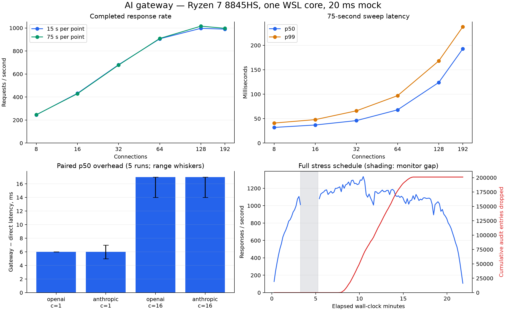

# Full gateway re-benchmark: 2026-10-14

Gateway source commit: `c065a6dc1b578cc786041366684da5a9d333b9cf`. Gateway implementation is unchanged; edits apply to benchmark instrumentation and reporting. All measurements use local mock providers or a local Ollama model. No paid provider requests were made.

## Findings

- Across 5 paired runs, median p50 overhead at concurrency 1 is 6 ms for OpenAI and 6 ms for Anthropic.
- Streaming TTFB overhead at concurrency 1 is 5.39 ms p50.
- The 75-second-per-point throughput sweep peaks at 1016 rps at concurrency 128, with p50 124 ms and p99 168 ms. This sweep has no HTTP or transport failures.
- All 3120 mock failover requests succeed, including the hanging-primary case.
- Important remaining limits and defects: aborted-client in-flight gauges leak; Redis loss stalls requests; peak stress drops audit entries (at least 201,051 observed); future rows in the default partition prevent creation of that month's partition.
- 206 existing tests pass (140 unit and 66 integration/e2e/security). Test success does not invalidate the defects found under load.

## Hardware and isolation

Ryzen 7 8845HS; Windows reports 8 cores / 16 threads and 16 GiB RAM. WSL2 is configured for 6 logical CPUs and 9 GiB RAM (8.7 GiB visible), with 4 GiB swap. NVIDIA RTX 3050 Laptop GPU has 4 GiB VRAM. Windows reports an enabled NPU with driver 32.0.203.329; WSL exposes no `/dev/accel` device, so no NPU inference result is claimed. GPU placement is recorded by Ollama rather than inferred from GPU availability.

| Component          | CPU affinity        | Memory limit             |
| ------------------ | ------------------- | ------------------------ |
| PostgreSQL + Redis | 0,1 (WSL core 0)    | 512 MiB + 256 MiB        |
| Gateway            | 2,3 (WSL core 1)    | 512 MiB; swap disallowed |
| Mock provider      | 4                   | Host process             |
| Load generator     | 5                   | Host process             |
| Ollama             | 4,5 plus NVIDIA GPU | Host process             |

The mock and generator share the third WSL-reported physical core. Gateway CPU percentages are relative to one logical CPU (200% permitted on its two SMT threads). Measurements are local HTTP/1.1 keep-alive without TLS, ingress, or network delay. Gateway uses production mode, warning-level logs, health monitoring off, and default latency-based balancing except the explicit breaker/failover block.

Node 22.14.0, autocannon 8.0.0, PostgreSQL 16.15, Redis 7.4.11, Docker 29.9.0, k6 2.3.0, Ollama 0.40.4. Image digests and live system data: [system-20261014.json](../benchmarks/results/system-20261014.json) and [windows-hardware-20261014.json](../benchmarks/results/windows-hardware-20261014.json).

## Method

Each non-streaming point discards 3 seconds of warm-up and measures 15 seconds. The sustained sweep measures 75 seconds per point, spanning the limiter's 60-second window. A single hot key has RPM/TPM limits of 2 billion. Mock upstream latency is fixed at 20 ms, with zero jitter. Cache is enabled but uncacheable requests are used for throughput. Exact cache hits and misses are measured separately. Overhead subtracts direct-provider latency from gateway latency at the same concurrency and with equivalent bodies. Higher-concurrency overhead includes queueing.

The streaming mock emits 20 tokens, 5 ms apart. Both provider protocols are parsed for their first actual content frame and terminal event. The 5 latency repetitions are independent runs of the paired measurement, not confidence intervals from one histogram. Autocannon latencies are histograms with millisecond resolution and describe successful responses; failures are reported separately. The long k6 tests use their own varying prompts and differ from the autocannon workload.

## Figures



[Vector figure](../benchmarks/results/overview-20261014.svg).

## Repeated latency measurements

| Adapter           | Concurrency | p50 overhead samples (ms) | Median (ms) | Range (ms) |
| ----------------- | ----------- | ------------------------- | ----------- | ---------- |
| openai-adapter    | 1           | 6, 6, 6, 6, 6             | 6           | 6–6        |
| anthropic-adapter | 1           | 5, 7, 6, 6, 6             | 6           | 5–7        |
| openai-adapter    | 16          | 17, 17, 17, 14, 16        | 17          | 14–17      |
| anthropic-adapter | 16          | 17, 17, 17, 14, 16        | 17          | 14–17      |

## Complete mock results

### Gateway overhead

| adapter           | conns | direct p50 | gateway p50 | overhead p50 | direct p99 | gateway p99 | overhead p99 | gateway rps | direct rps |
| ----------------- | ----- | ---------- | ----------- | ------------ | ---------- | ----------- | ------------ | ----------- | ---------- |
| openai-adapter    | 1     | 21.0       | 27.0        | 6.0          | 23.0       | 30.0        | 7.0          | 37          | 47         |
| anthropic-adapter | 1     | 21.0       | 26.0        | 5.0          | 22.0       | 31.0        | 9.0          | 37          | 47         |
| openai-adapter    | 16    | 20.0       | 37.0        | 17.0         | 22.0       | 50.0        | 28.0         | 422         | 770        |
| anthropic-adapter | 16    | 20.0       | 37.0        | 17.0         | 22.0       | 52.0        | 30.0         | 427         | 770        |

### Streaming

| path             | n   | conc | failures | TTFB p50 | TTFB p99 | TTFT p50 | TTFT p99 | total p50 | total p99 |
| ---------------- | --- | ---- | -------- | -------- | -------- | -------- | -------- | --------- | --------- |
| directOpenAI     | 400 | 16   | 0        | 21.0     | 47.8     | 21.0     | 47.8     | 127.1     | 149.9     |
| gatewayOpenAI    | 400 | 16   | 0        | 30.5     | 38.9     | 30.6     | 38.9     | 138.3     | 151.0     |
| directAnthropic  | 400 | 16   | 0        | 20.9     | 29.1     | 20.9     | 29.1     | 126.6     | 138.1     |
| gatewayAnthropic | 400 | 16   | 0        | 31.2     | 42.0     | 31.2     | 42.0     | 139.6     | 150.0     |
| directOpenAI_c1  | 150 | 1    | 0        | 21.6     | 23.0     | 21.6     | 23.0     | 125.9     | 133.6     |
| gatewayOpenAI_c1 | 150 | 1    | 0        | 27.0     | 34.2     | 27.0     | 34.3     | 130.8     | 138.2     |

overhead (gateway - direct, p50 ms): {"openai_c16":{"ttfb":9.54,"ttft":9.54,"total":11.17},"anthropic_c16":{"ttfb":10.31,"ttft":10.3,"total":13.07},"openai_c1":{"ttfb":5.39,"ttft":5.4,"total":4.9}}
metrics before: gateway_http_requests_total{method="POST",route="/v1/chat/completions",status_code="200",service="ai-gateway"} 16374 ; gateway_in_flight_requests{service="ai-gateway"} 62
metrics after: gateway_http_requests_total{method="POST",route="/v1/chat/completions",status_code="200",service="ai-gateway"} 17324 ; gateway_in_flight_requests{service="ai-gateway"} 62
streams sent: 1900

### Throughput: 15-second sweep

| conns | rps | p50 ms | p99 ms | max ms | non-2xx | transport errors (incl. timeouts) | gw CPU % (of 1 core) | gw mem MiB | mock CPU % | loadgen CPU % | redis evalsha us/call | pg commits |
| ----- | --- | ------ | ------ | ------ | ------- | --------------------------------- | -------------------- | ---------- | ---------- | ------------- | --------------------- | ---------- |
| 8     | 245 | 32.0   | 41.0   | 49.0   | 0       | 0                                 | 50.8                 | 90.2       | 4          | 4             | 20.12                 | 4244       |
| 16    | 432 | 36.0   | 50.0   | 57.0   | 0       | 0                                 | 65.4                 | 95.4       | 5          | 5             | 16.85                 | 7733       |
| 32    | 681 | 46.0   | 65.0   | 77.0   | 0       | 0                                 | 92.7                 | 104.3      | 7          | 6             | 15.15                 | 12229      |
| 64    | 906 | 69.0   | 95.0   | 176.0  | 0       | 0                                 | 117.9                | 112.7      | 7          | 8             | 13.76                 | 16140      |
| 128   | 997 | 126.0  | 166.0  | 553.0  | 0       | 0                                 | 127.3                | 126.4      | 7          | 8             | 11.91                 | 17900      |
| 192   | 990 | 188.0  | 240.0  | 1210.0 | 0       | 0                                 | 131.9                | 133.1      | 6          | 8             | 11.74                 | 17900      |

max rps: 997; stopped: saturated: rps gain <5% at c=192

### Cache hit vs miss

status samples: {"first":"MISS","second":"HIT","uncacheable":"SKIP"}

| run             | rps  | p50 ms | p90 ms | p99 ms | non-2xx |
| --------------- | ---- | ------ | ------ | ------ | ------- |
| hit_c1          | 444  | 2.0    | 2.0    | 4.0    | 0       |
| miss_c1         | 36   | 27.0   | 28.0   | 31.0   | 0       |
| uncacheable_c1  | 38   | 26.0   | 27.0   | 28.0   | 0       |
| hit_c16         | 1806 | 8.0    | 10.0   | 16.0   | 0       |
| miss_c16        | 406  | 39.0   | 42.0   | 49.0   | 0       |
| uncacheable_c16 | 419  | 37.0   | 42.0   | 50.0   | 0       |

### Rate limiter correctness under burst

| limit    | requests | concurrency | allowed (200) | rejected (429) | exact? | wall ms | retry-after sample |
| -------- | -------- | ----------- | ------------- | -------------- | ------ | ------- | ------------------ |
| 60 rpm   | 300      | 100         | 60            | 240            | true   | 362     | 60                 |
| 100 rpm  | 1000     | 200         | 100           | 900            | true   | 781     | 60                 |
| 600 rpm  | 2000     | 200         | 600           | 1400           | true   | 1510    | 60                 |
| 5000 tpm | 20       | 4           | 3             | 17             | n/a    | 44      | 60                 |

### Warm memory footprint

idle: 132.2MiB / 512MiB|2.19%
under load (c=64): {"samples":11,"maxMemMiB":133.5,"avgCpuPct":116.8,"maxCpuPct":119.55}; rps 894
after settle: 132.4MiB / 512MiB|3.20%
process_cpu_seconds_total{service="ai-gateway"} 265.595358
process_resident_memory_bytes{service="ai-gateway"} 189296640
nodejs_heap_size_used_bytes{service="ai-gateway"} 55100016

### Throughput

| conns | rps  | p50 ms | p99 ms | max ms | non-2xx | transport errors (incl. timeouts) | gw CPU % (of 1 core) | gw mem MiB | mock CPU % | loadgen CPU % | redis evalsha us/call | pg commits |
| ----- | ---- | ------ | ------ | ------ | ------- | --------------------------------- | -------------------- | ---------- | ---------- | ------------- | --------------------- | ---------- |
| 8     | 246  | 32.0   | 41.0   | 72.0   | 0       | 0                                 | 50.3                 | 97.2       | 4          | 3             | 19.78                 | 18970      |
| 16    | 429  | 37.0   | 48.0   | 68.0   | 0       | 0                                 | 71.4                 | 104.2      | 5          | 5             | 18.33                 | 33405      |
| 32    | 678  | 46.0   | 66.0   | 94.0   | 0       | 0                                 | 94.4                 | 112.6      | 6          | 6             | 16.56                 | 52745      |
| 64    | 909  | 68.0   | 97.0   | 168.0  | 0       | 0                                 | 117.3                | 124.9      | 7          | 8             | 14.79                 | 70900      |
| 128   | 1016 | 124.0  | 168.0  | 463.0  | 0       | 0                                 | 129.7                | 138.1      | 6          | 8             | 13.41                 | 79050      |
| 192   | 997  | 193.0  | 238.0  | 1200.0 | 0       | 0                                 | 135                  | 147.1      | 6          | 8             | 12.62                 | 77742      |

max rps: 1016; stopped: saturated: rps gain <5% at c=192

### failover

| scenario                     | ok rate | status codes | lat p50 | lat p95 | lat p99 | lat max | failover hist    | A reqs | B reqs |
| ---------------------------- | ------- | ------------ | ------- | ------- | ------- | ------- | ---------------- | ------ | ------ |
| healthy_baseline             | 100.0%  | {"200":600}  | 35.9    | 43.6    | 111.3   | 123.2   | {"0":600}        | 300    | 300    |
| primary_503_always           | 100.0%  | {"200":600}  | 34.3    | 42.0    | 55.9    | 62.3    | {"0":592,"1":8}  | 8      | 600    |
| primary_429_always           | 100.0%  | {"200":600}  | 32.5    | 38.5    | 55.0    | 61.0    | {"0":594,"1":6}  | 6      | 600    |
| primary_50pct_503            | 100.0%  | {"200":600}  | 31.7    | 53.7    | 56.7    | 59.6    | {"0":504,"1":96} | 190    | 506    |
| primary_connection_reset     | 100.0%  | {"200":600}  | 33.1    | 39.3    | 44.2    | 46.9    | {"0":594,"1":6}  | 6      | 600    |
| primary_hangs_timeout_1500ms | 100.0%  | {"200":120}  | 34.4    | 1529.8  | 1554.5  | 1554.7  | {"0":112,"1":8}  | 8      | 120    |

### Circuit breaker timing

```json
{
  "meta": {
    "date": "2026-10-14T11:17:24.476Z",
    "node": "v22.14.0",
    "host": {
      "cpu": "AMD Ryzen 7 8845HS w/ Radeon 780M Graphics",
      "cpus": 6,
      "totalMemMB": 8940
    },
    "autocannon": "8.0.0"
  },
  "cbTimeoutMs": 5000,
  "tOpenMs": 622,
  "upstreamRequestsToAUntilOpen": 5,
  "upstreamRequestsToAWhileOpen": 0,
  "healedAtMs": 3657,
  "tHalfOpenMs": 5667,
  "tClosedMs": 5769,
  "openToHalfOpenMs": 5045,
  "healToClosedMs": 2112,
  "clientRequests": {
    "total": 116,
    "ok": 116
  },
  "clientSuccessRate": 1,
  "pollIntervalMs": 100
}
```

timeline: 2ms CLOSED -> 622ms OPEN -> 5667ms HALF_OPEN -> 5769ms CLOSED

### Outage probe summary

baseline: n=10 codes={"200":10} lat p50=31.0 max=67.0 ms
redisDown: n=8 codes={"500":1,"client-timeout-20s":7} lat p50=20000.0 max=20000.0 ms
postgresDown: n=8 codes={"200":8} lat p50=29.0 max=33.0 ms
redis recovery ms: 1820; postgres recovery ms: 30
postgres-down streaming: {"failures":0,"ttfb":{"n":3,"mean":27.92,"p50":27.47,"p90":29.45,"p95":29.45,"p99":29.45,"max":29.45}}

The memory check runs after earlier load: warm idle is 132.2MiB, c=64 maximum is 133.5 MiB, and settled memory is 132.4MiB. The sustained sweep maximum is 147.1 MiB. These container working-memory figures are distinct from process RSS and are not cold-start measurements.

## Limiter on/off: 75-second comparisons

| Limiter | Concurrency | RPS | p50 ms | p99 ms | HTTP failures | Transport errors |
| ------- | ----------- | --- | ------ | ------ | ------------- | ---------------- |
| off     | 64          | 957 | 65     | 95     | 0             | 0                |
| on      | 64          | 888 | 70     | 107    | 0             | 0                |

Redis Lua figures in the throughput table aggregate all scripts and cover warm-up plus measurement; they do not isolate the limiter's individual script.

## Client aborts and metrics

| Case                                | Clients | Upstream active at abort | Upstream drained after (ms) | Gauge before | Gauge after |
| ----------------------------------- | ------- | ------------------------ | --------------------------- | ------------ | ----------- |
| stream_abort_mid_generation         | 40      | 40                       | 71                          | 1            | 41          |
| nonstream_abort_while_upstream_slow | 40      | 40                       | 65                          | 41           | 81          |

The metrics request itself contributes one active request. Both aborted-client cases leak +40 in the gauge even though upstream work drains. Streaming completion counts remain correct. The leaked gauge must not be used to infer active load or capacity. These results reproduce the issue on actual client disconnections, despite the earlier onRequestAbort fix.

## Dependency outages

Redis outage probes: {"500":1,"client-timeout-20s":7}. The 20-second values are client deadlines, not completed server response times. First successful recovery probe arrives 1820 ms after restart. PostgreSQL connection-refusal probes: {"200":8}, with 0 failed streams among 3. This does not establish blackholed-connection behavior or durable logging during a database outage.

The separate partition check reproduces the future-row/default-partition issue; the synthetic row is removed afterward. [partition-check-20261014.txt](../benchmarks/results/partition-check-20261014.txt).

## Full k6 schedules

| Schedule | Duration | HTTP requests | Mean RPS | p50 ms | p95 ms | HTTP failure rate | Failed thresholds |
| -------- | -------- | ------------- | -------- | ------ | ------ | ----------------- | ----------------- |
| baseline | 5 min    | 14556         | 48.36    | 29.38  | 34.84  | 0.0000%           | none              |
| stress   | 20 min   | 1201206       | 917.49   | 233.39 | 463.97 | 0.0000%           | none              |
| failover | 3 min    | 8752          | 48.48    | 29.36  | 37.24  | 0.0000%           | none              |

Baseline: 50 constant VUs, one-second sleeps. Stress: 0→50→200→500→500→200→50→0 over the complete 20-minute schedule. Failover: 50 constant VUs while the primary is disabled at 60 seconds and restored at 120 seconds; provider update success is checked and thresholded.

At least 201,051 audit queue drops were observed in the long stress phase. The bounded background logger protects response availability by discarding entries when its 1,000-write queue fills. Successful HTTP responses therefore do not imply complete audit logs. Client summary thresholds do not check audit completeness. The stress test maximum is 109.37 seconds, coinciding with a 119.23-second gap between nominally 10-second host-monitor samples. This is consistent with a host/VM scheduling pause; gateway-specific attribution of that extreme tail is uncertain. The full stress mean rate includes the elapsed pause. Numeric p99 is absent from these legacy k6 summaries; the baseline's p99<500 ms threshold is still evaluated. Time-series snapshots: [monitor-20261014.jsonl](../benchmarks/results/monitor-20261014.jsonl).

## GPU-backed local model

Model: `qwen2.5:0.5b`; backend label: `gpu`.

| Path              | N   | Concurrency | TTFT p50 ms | TTFT p99 ms | Decode tokens/s p50 | Errors |
| ----------------- | --- | ----------- | ----------- | ----------- | ------------------- | ------ |
| stream_direct_c1  | 20  | 1           | 22.14       | 34.23       | 200.21              | 0      |
| stream_gateway_c1 | 20  | 1           | 28.17       | 43.23       | 212.8               | 0      |
| stream_direct_c2  | 20  | 2           | 26.45       | 40          | 179.1               | 0      |
| stream_gateway_c2 | 20  | 2           | 34.04       | 47.1        | 196.43              | 0      |

| Non-streaming path | N   | p50 ms | p99 ms |
| ------------------ | --- | ------ | ------ |
| nonstream_direct   | 20  | 321.51 | 432.38 |
| nonstream_gateway  | 20  | 306.18 | 346.53 |

Model load / first warm-up request: 53222 ms (excluded from comparisons). Real-model failover returned 20/20 HTTP 200 responses. Processor placement: [ollama-processor-20261014.txt](../benchmarks/results/ollama-processor-20261014.txt); temperature samples: [ollama-thermal-20261014.csv](../benchmarks/results/ollama-thermal-20261014.csv). This small local run demonstrates a real upstream and accounting; its sequential direct/gateway order and model prefix-cache effects do not establish precise isolated overhead. Use the paired mock measurements for that.

Ollama confirms 25/25 layers offloaded and 100% GPU placement on the 4 GiB RTX 3050 Laptop GPU; peak sampled temperature is 67°C.

Core usage fields (prompt, completion, total tokens) agree in 4/4 deterministic direct/gateway pairs. Ollama's prompt_tokens_details.cached_tokens field is omitted by the gateway. The local run records 65 audit rows, 2964 prompt tokens, 4160 completion tokens, and $0.011284 at synthetic benchmark prices. Client-observed decode rate is completion tokens divided by elapsed time after the first content frame. Accounting evidence: [ollama-main-20261014.json](../benchmarks/results/ollama-main-20261014.json). Synthetic model prices in the benchmark are accounting inputs, not an actual provider bill.

## CPU and microbenchmarks

```text

> ai-gateway@1.0.0 benchmark
> tsx scripts/benchmark.ts

AI gateway microbenchmarks

cache key derivation             384493 ops/s      2600.8 ns/op
LB candidate-set key            1007252 ops/s       992.8 ns/op

Done.

```

CPU profile summary (percentages are sampled wall time, not fractions of total CPU cycles):

```text
total sampled: 111846 ms over 88293 samples

== top functions (self time) ==
 30.4%    33969 ms  (garbage collector)  (native):0
 25.5%    28490 ms  (idle)  (native):0
  4.7%     5249 ms  writev  (native):0
  1.6%     1779 ms  runMicrotasks  (native):0
  1.5%     1722 ms  (program)  (native):0
  1.5%     1660 ms  writeUtf8String  (native):0
  1.3%     1501 ms  is  node_modules/drizzle-orm/entity.js:3
  0.9%     1010 ms  (anonymous)  node_modules/drizzle-orm/sql/sql.js:83
  0.9%      979 ms  NodeError  node:internal/errors:466
  0.5%      575 ms  buildQueryFromSourceParams  node_modules/drizzle-orm/sql/sql.js:70
  0.5%      524 ms  (anonymous)  (native):0
  0.4%      419 ms  _parse  node_modules/zod/v3/types.js:1934
  0.4%      417 ms  Command  node_modules/ioredis/built/Command.js:37
  0.4%      416 ms  (anonymous)  node_modules/ioredis/built/utils/Commander.js:74
  0.3%      372 ms  sendCommand  node_modules/ioredis/built/Redis.js:338
  0.3%      344 ms  writevGeneric  node:internal/stream_base_commons:121
  0.3%      340 ms  processTicksAndRejections  node:internal/process/task_queues:72
  0.3%      328 ms  readJson  dist/providers/base.js:101
  0.3%      321 ms  set natives  (native):0
  0.3%      317 ms  setHeader  node:_http_outgoing:697
  0.3%      316 ms  DOMException  node:internal/per_context/domexception:52
  0.3%      314 ms  deprecate  node:internal/util:149
  0.3%      314 ms  chat  dist/providers/openai.js:100
  0.3%      313 ms  buildInsertQuery  node_modules/drizzle-orm/pg-core/dialect.js:356
  0.3%      311 ms  __name  node:internal/deps/undici/undici:4
  0.3%      288 ms  cloneQueryConfig  node_modules/pg/lib/utils.js:171
  0.3%      287 ms  _storeHeader  node:_http_outgoing:454
  0.2%      245 ms  emit  node:events:465
  0.2%      243 ms  _parse  node_modules/secure-json-parse/index.js:17
  0.2%      237 ms  (anonymous)  dist/routes/completions.js:26

== top files/packages ==
 66.7%    74570 ms  (native)
  5.4%     6010 ms  node:internal/deps/undici/undici
  4.2%     4714 ms  node_modules/drizzle-orm
  3.0%     3366 ms  node_modules/ioredis
  1.5%     1659 ms  node:internal/webstreams/readablestream
  1.3%     1419 ms  node_modules/fastify
  1.2%     1291 ms  node_modules/zod
  1.1%     1178 ms  node:internal/errors
  0.8%      864 ms  node:internal/stream_base_commons
  0.7%      818 ms  node:_http_outgoing
  0.7%      790 ms  node:internal/streams/readable
  0.7%      771 ms  node:events
  0.7%      735 ms  node_modules/pg
  0.6%      622 ms  dist/services/router.js
  0.5%      590 ms  node:internal/process/task_queues
  0.5%      557 ms  node:_http_server
  0.5%      515 ms  dist/providers/base.js
  0.4%      487 ms  node_modules/prom-client
  0.4%      478 ms  node:net
  0.4%      456 ms  node_modules/helmet
  0.4%      418 ms  node:internal/perf/observe
  0.4%      406 ms  node_modules/pg-pool
  0.4%      402 ms  node_modules/pg-protocol
  0.4%      392 ms  node:internal/streams/writable
  0.3%      379 ms  dist/providers/openai.js
  0.3%      357 ms  node:internal/util
  0.3%      341 ms  node:internal/abort_controller
  0.3%      332 ms  dist/services/cost-tracker.js
  0.3%      316 ms  node:internal/per_context/domexception
  0.3%      288 ms  dist/routes/http.js

```

Compressed raw profile: [profile-20261014.tar.gz](../benchmarks/results/profile-20261014.tar.gz). Profiling changes performance and its throughput numbers are not the capacity headline.

## Reproducing

| Block       | Label              | Started UTC          | Finished UTC         | Exit status |
| ----------- | ------------------ | -------------------- | -------------------- | ----------- |
| A           | 20261014           | 2026-10-14T10:52:46Z | 2026-10-14T11:01:16Z | 0           |
| R           | 20261014           | 2026-10-14T11:01:16Z | 2026-10-14T11:06:12Z | 2           |
| S           | 20261014-sustained | 2026-10-14T11:06:12Z | 2026-10-14T11:16:54Z | 0           |
| B           | 20261014           | 2026-10-14T11:16:54Z | 2026-10-14T11:17:28Z | 0           |
| C           | 20261014           | 2026-10-14T11:17:28Z | 2026-10-14T11:20:34Z | 0           |
| D           | 20261014           | 2026-10-14T11:20:34Z | 2026-10-14T11:22:35Z | 1           |
| D-artifacts | 20261014           | 2026-10-14T11:49:47Z | 2026-10-14T11:49:47Z | 0           |
| K           | 20261014           | 2026-10-14T11:22:35Z | 2026-10-14T11:52:36Z | 0           |
| ollama      | 20261014           | 2026-10-14T11:52:36Z | 2026-10-14T11:57:01Z | 0           |
| R-recovery  | 20261014-recovery  | 2026-10-14T11:57:01Z | 2026-10-14T12:01:57Z | 0           |

The initial repeat block saved both results before a live-script editing error affected final bookkeeping. It was rerun under a recovery label. The profile was captured successfully but initially unreadable to the host user because Docker wrote it as root; ownership and post-processing were corrected. Original failure records are retained. Numerical or functional failures in benchmark data are reported independently from shell exit status.

```bash
npm ci && npm run build
(cd benchmarks && npm ci)
gateway_bench_label=$(date -u +%Y%m%dT%H%M%SZ)
BENCH_LABEL="$gateway_bench_label" \
  GW_CPUS=2,3 MOCK_CPUS=4 LOAD_CPUS=5 OLLAMA_CPUS=4,5 \
  OLLAMA_N=20 GATEWAY_BENCH_OLLAMA_DIR=/path/to/task-owned/ollama \
  benchmarks/rebenchmark.sh
node benchmarks/summarize.mjs "$gateway_bench_label" "$gateway_bench_label-sustained"
```

Requires Node 22, Docker, k6, and a dedicated extracted Ollama installation. Use the same shell variable for the result label when generating tables. The report renderer also requires correspondingly labelled hardware snapshots and test logs. Generate the dated report with `node benchmarks/report.mjs <label>`; add `--current` only when promoting that completed run to `docs/benchmarks.md`. Generate figures with `python benchmarks/plot.py <label>` in an environment with matplotlib. The [artifact index](../benchmarks/results/README.md) distinguishes current raw measurements from historical files. The local Node and k6 installations are under `~/.local/share/gateway-benchmark/`; add their bin directories to PATH. Ollama's task-owned model directory and benchmark containers are removed after use. Gateway source is unchanged; harness fixes cover transport-error accounting, complete burst accounting, Anthropic content-frame parsing, profiling flags/ownership, labelled outputs, and verification of k6 provider updates.

Historical 2026-10-04 figures remain in [the archived report](archive/benchmarks-20261004.md). The CPU, available resources, code, and software versions differ, so this re-run is not a controlled causal before/after experiment. No cloud, TLS, ingress, multi-replica, or NPU performance claim is made.
